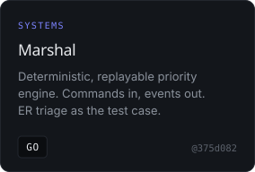
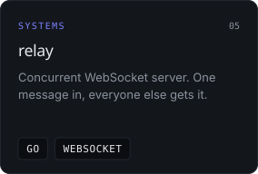
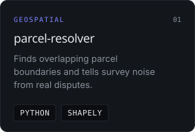
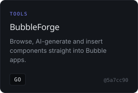
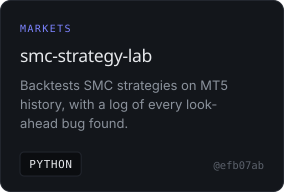
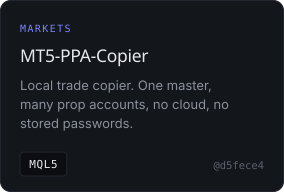

<a href="https://groundwork-three-chi.vercel.app">groundwork live demo ↗</a> · <a href="https://github.com/MaweuPaul/groundwork/blob/main/docs/design/multi-analysis.md">how the evidence chain works ↗</a>

  
  
  

  
  
  

  
  
  

